# 拟态主题 · 功能刘海（dsh-nitai-theme）

给本机 DeepSeek Harness 桌面端做的一套拟态风格主题，外加一个顶部功能刘海。主题和刘海都装在一个本地插件里，跟随 DSH 自带的明暗切换，不修改任何 DSH 源文件。

## 现在长什么样

亮色与暗色，都是冷灰底 + 浮起的浅色卡片 + 左上受光、右下投影的软阴影；强调色是低饱和的青蓝。

| 亮色 | 暗色 |
| --- | --- |
| 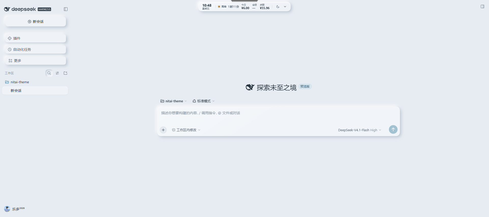 | 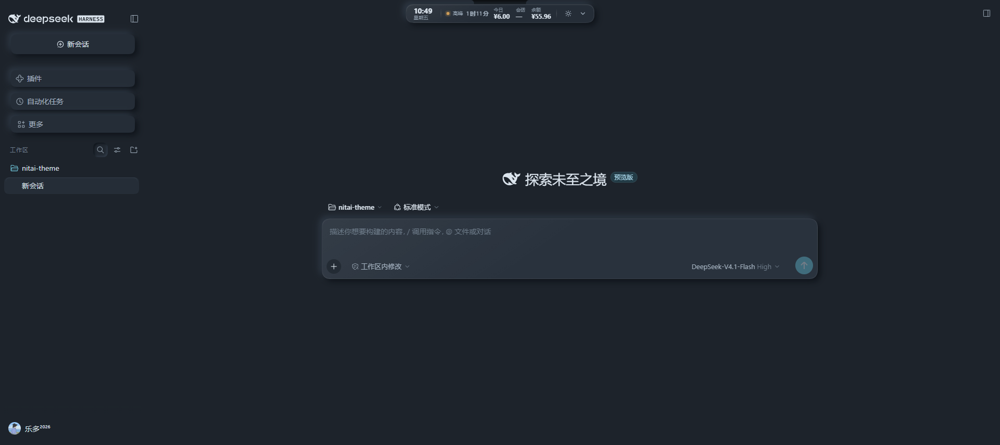 |

刘海展开后的面板：

| 亮色面板 | 暗色面板 |
| --- | --- |
| 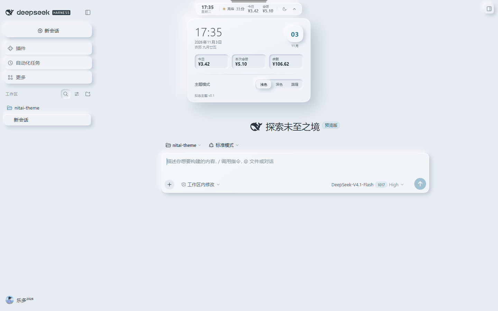 | 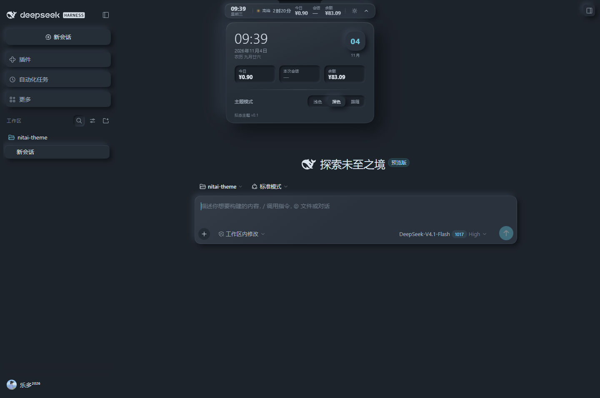 |

侧栏会话或工作区在鼠标悬停时弹出的卡片也改成了拟态卡片，不再是固定的深色浮层：

| 亮色悬浮卡 | 暗色悬浮卡 |
| --- | --- |
|  | 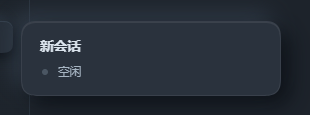 |

接入 OpenCode Go 订阅后，刘海会自动换成用量百分比模式，下面是在真实 Go 订阅账号下截的图（5 小时 4%、本周 1%、本月 0%）：

| Go 模式·亮色 | Go 模式·暗色 |
| --- | --- |
| 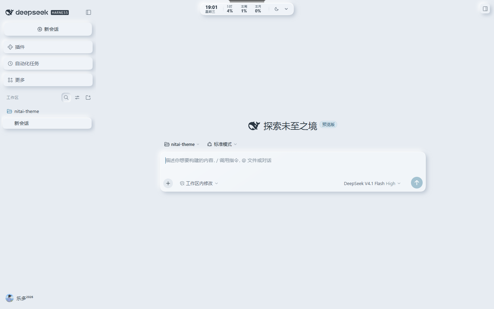 | 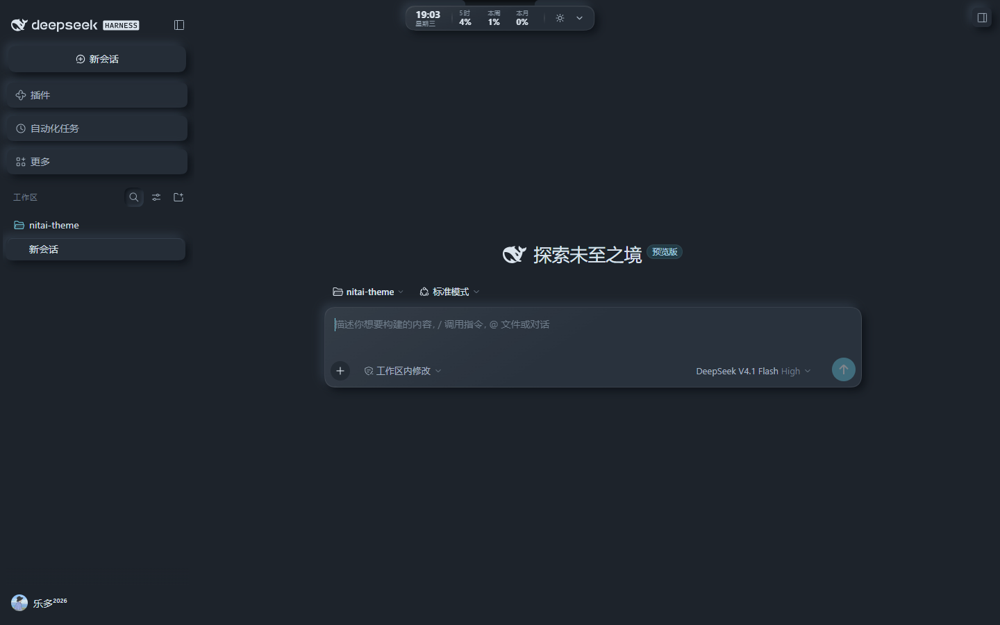 |

面板里的三格也换成用量，并在每格下面写重置倒计时，再补一行模型名、月额度与上下文长度：

| Go 面板·亮色 | Go 面板·暗色 |
| --- | --- |
| 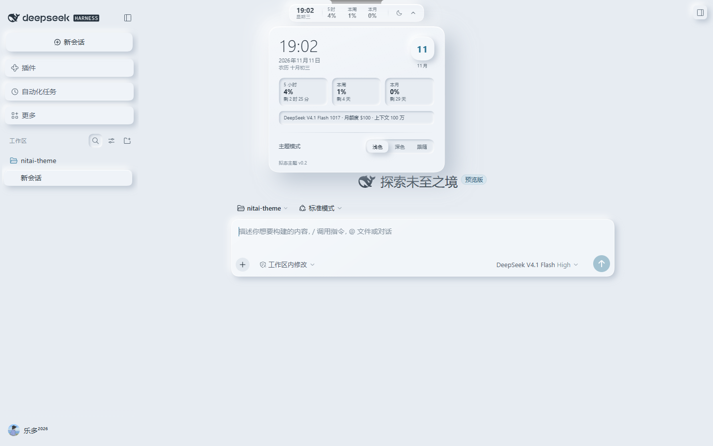 | 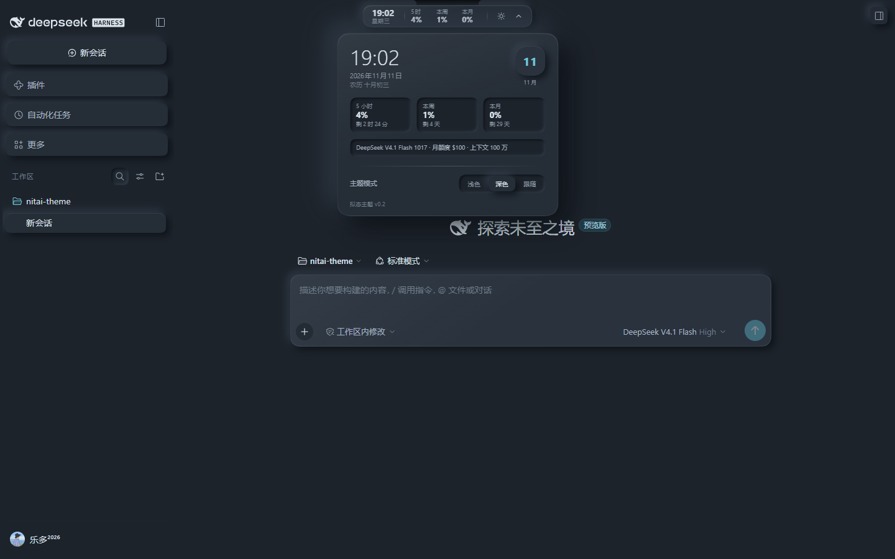 |

独立预览页（模拟了聊天、气泡、代码块、表格和输入卡，方便不启动 DSH 也能看主题）：

| 预览亮色 | 预览暗色 |
| --- | --- |
| 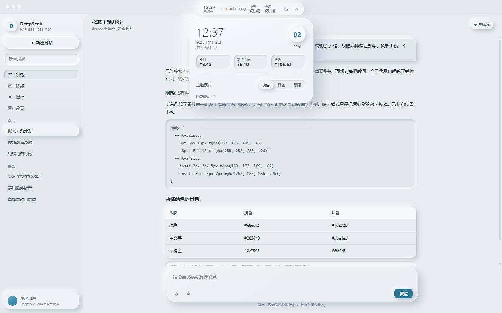 | 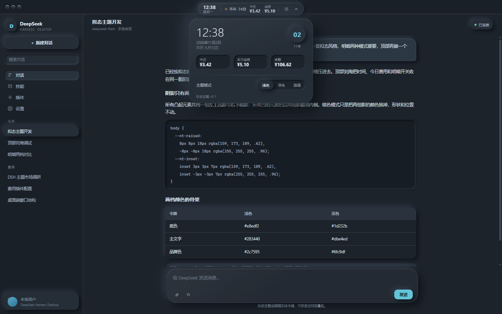 |

## 安装状态

已经装进本机的桌面端配置：

- 插件目录：`C:\Users\18385\Documents\dsh\nitai-theme`
- 桌面端 profile：`C:\Users\18385\.dsh\profiles\desktop`
- 已建立目录链接：`node_modules\dsh-nitai-theme` → 上面的插件目录
- `package.json` 里已加入依赖 `dsh-nitai-theme`，并加入 `dsh.profile.bundles`
- 原文件备份在 `C:\Users\18385\.dsh\profiles\desktop\package.json.bak-nitai`

**重启 DeepSeek Harness 桌面端后生效。** 当前正在运行的窗口不会热加载这个插件。

## 刘海怎么用

刘海固定在窗口顶部中间，不遮挡两侧的窗口拖动区，也不影响右上角的窗口按钮。

收起时从左到右依次是：

1. 当前时间（每秒更新）
2. 星期几
3. 峰谷状态圆点、状态文字和倒计时（由主题自己按北京时间计算）
4. 今日费用
5. 本次会话费用
6. 余额（和费用同一行显示，没登录时这一项隐藏）
7. 月亮 / 太阳按钮：一键切换亮暗
8. 向下箭头：展开面板

如果当前会话用的是 OpenCode Go 的模型，第 3～6 项会整组换成 OpenCode Go 的用量：

- `5时`、`本周`、`本月` 三个百分比，分别对应 5 小时窗口、本周、本月的额度占用
- 超过 85% 转成警示色，达到 100% 转成错误色，一眼能看出快用完
- 悬停在百分比上有原生的 `title` 提示，显示这一档什么时候重置

展开面板里有：

- 大号时钟、完整日期、农历
- 今天的日号、月份
- 今日费用、本次会话费用、余额三格（OpenCode Go 模式下换成 5 小时 / 本周 / 本月三格的百分比，每格下面一行小字是重置倒计时）
- OpenCode Go 模式下再多一行模型信息：模型名 · 月额度 · 上下文长度；额度表用的是内置参考值时，这一行会注明
- 主题模式三段开关：浅色 / 深色 / 跟随系统
- “费用设置”入口：直接打开 `dsh-cost-notch` 的设置（只在 DeepSeek 计费模式下显示）

点面板外面或按 `Esc` 关闭面板。主题选择会写进浏览器的 `localStorage`，键名是 `dsh-nitai-theme.mode`，值是 `light`、`dark` 或 `auto`。桌面端每次启动可能换本地端口，而 `localStorage` 按端口隔离，所以同时写了一份 Cookie（`nt_mode`，按主机共享），换端口后仍然记得住。没有选过时跟随系统。

## 和 dsh-cost-notch 的关系

费用不再依赖 `dsh-cost-notch` 才能显示。主题宿主自己监听会话事件，每收到一条带用量的助手消息，就按同一套价格表把这一轮的费用累加进自己的账本：

- 账本文件：`C:\Users\18385\.dsh\nitai-theme\usage.json`
- 第一次启动时，会从 `dsh-cost-notch` 的旧账本 `C:\Users\18385\.dsh\cost-notch\ledger.json` 补一次历史数据；如果旧账本比实际落后，会再读当前会话的事件日志（`~/.dsh/sessions/.../session.v4.jsonl.zstd`）补差额，不会重复累加
- 之后两边同时记账时取较大值，不会相加翻倍
- 峰谷状态按北京时间计算，不读网络
- 余额仍向 DSH 的账户服务查询；没有登录或查询失败时余额项隐藏，不影响时间和费用

本机已经装了 `dsh-cost-notch`，它原本也有一条顶部费用条。两个都显示会叠在一起，所以这个主题在检测到 `.dshcn-notch` 时：

- 给 `body` 加 `nt-has-costbar`
- 用 CSS 把原来的顶部费用条隐藏
- 显示“费用设置”入口，点了直接打开 `dsh-cost-notch` 的设置
- 输入框下方的会话费用胶囊保持原样，不动

如果想让原来的费用条回来，删掉 `lib/theme.css` 里这条规则即可：

```css
body.nt-has-costbar .dshcn-notch {
  display: none !important;
}
```

`dsh-cost-notch` 停用也不会影响新刘海的时间和费用；“费用设置”入口会跟着消失。费用每 60 秒刷新一次，切换会话时也会立即刷新。

## OpenCode Go 用量模式

同一条刘海现在管两种计费方式：DeepSeek 官方模型按金额算，OpenCode Go 订阅按额度百分比算。切换是自动的，不用手动开。

### 怎么判断当前该用哪种

宿主读当前会话的事件日志：

- 日志里出现 `model/selection` 事件，取它的 `provider` 字段；没有这条事件时，退回最后一条助手消息的 `message.source.provider`
- `provider` 是 `opencode-go` 或 `opencode` → 走 OpenCode Go 模式
- `provider` 是 `deepseek-official` → 走原来的 DeepSeek 模式（今日 / 会话 / 余额）
- 当前会话还没有任何模型事件时（例如刚打开一个空对话），读 profile 里的 `agent-default-model`，10 秒缓存

所以同一个窗口里，换个模型、切个会话，刘海下一次刷新（最长 60 秒，或者一打开面板）就跟着换。

### 数据从哪来

| 数据 | 来源 | 说明 |
| --- | --- | --- |
| 5 小时 / 本周 / 本月用量 | `GET https://opencode.ai/zen/go/v1/usage` | 需要 `Authorization: Bearer <OPENCODE_GO_API_KEY>`；上游返回的是**账户级**百分比，不分模型 |
| 模型名、上下文长度 | `GET https://opencode.ai/inference/go/v1/models` | 公开接口，不需要密钥 |
| 每个模型的月额度 | 文档页 `https://opencode.ai/docs/console/go/` 的每月限制表 | 没有接口，只能解析页面；解析结果缓存 24 小时，失败时退回上一次的缓存，再退回内置表 |

- 5 小时额度和周额度是按文档给的比例换算的：5 小时 = 月额度 20%，周 = 月额度 50%，月 = 月额度本身
- 内置表在 `lib/opencode.js` 的 `BUILTIN_MONTHLY_LIMITS`，共 32 个模型，数值取自 2026-11-11 的文档页；文档改价后，只要页面还能解析，就会自动用新值，内置表只是兜底
- 用量结果缓存 120 秒，取失败缓存 30 秒（免得一遍遍重试）；同一时间只发一次请求，并发的请求共用同一个结果；上游超时 10 秒，响应体上限 2MB

### 密钥怎么取

不读配置文件，走 DSH 自己的凭据服务：先用 `llm-pi-ai.providers['opencode-go'].apiKeyEnv` 里的名字，取不到再用分区默认的 `OPENCODE_API_KEY` / `OPENCODE_GO_API_KEY`。全程只在请求头里用一次，不落盘、不回传浏览器。

### 取不到用量时显示什么

百分比位置显示 `—`，并在第一格下面写一行原因：

| 原因 | 面板上的文字 |
| --- | --- |
| 没配置密钥 | 未配置 OpenCode 密钥 |
| 密钥被拒（401/403） | OpenCode 密钥无效 |
| 超时或网络不通 | 用量接口暂时连不上 |
| 返回的不是预期结构 | 用量数据格式异常 |
| 上游返回其它错误 | 用量接口返回错误 |

这几种情况下，刘海其余部分（时间、星期、明暗切换、面板）都正常，不会弹错误框。

### 本地路由的信任判定

`/dsh-nitai-theme/state.json` 会返回余额和用量，所以注册路由时会先问 DSH 的连接服务要一次判定（`ctx.get('connection').requestRejection(req)`）：判定服务不存在、或者返回了拒绝，就直接按 403 处理，不返回数据。这条是“取不到判定就拒绝”，不是“取不到判定就放行”。

## 主题是怎么实现的

DSH 的主题色是 CSS 自定义属性，运行时由布局插件把令牌写在 `body` 的行内样式里，所以普通选择器压不过它。这个插件分三块：

1. `lib/index.js`（宿主侧）
   - 监听 `webserver/index-inject`，往页面 `<body>` 开头插一段 `<style id="nitai-theme-css">`，再插一个 `<script src="/dsh-nitai-theme/client.js">`
   - 注册 `/dsh-nitai-theme/client.js`、`/dsh-nitai-theme/theme.css`、`/dsh-nitai-theme/state.json` 和 `/dsh-nitai-theme/health` 四个本地路由
   - 监听会话的 `assistant/message` 事件，用 `lib/pricing.js` 的价格表累计今日和本次会话的费用
   - 样式放在 body 而不是 head，保证晚于 DSH 自己的样式表加载

2. `lib/theme.css`（主题样式）
   - 用 `!important` 重定义中性色阶和关键语义令牌：背景、表面、文字、边框、品牌色、状态色、代码块、表格、菜单、输入框
   - 亮色写在 `body`，暗色写在 `body[data-ds-dark-theme]`，两档一一对应
   - 用两组合成的软阴影做拟态：凸起是“左上白影 + 右下灰影”，凹陷是把同一组影子翻到内侧
   - 侧栏、会话头部、标签、用户气泡、任务面板这些组件用精确类名选择器补齐，例如 `[class~="wtg9ga_root"]`、`[class~="an3WzG_tabActive"]`；用 `~=` 而不是 `*=`，是为了不把 `newSessionLabelMask` 这类子元素一起选中
   - 侧栏会话/工作区的悬停卡片原生固定是深色浮层，这里用 `[class*="_card"]:has(> [class~="wnFoaW_hoverContent"])` 改成跟随明暗的拟态卡片，并覆盖标题、时间、路径、状态文字的颜色
   - 侧栏、中心区和右栏共用同一张画布：三列容器透明，侧栏/右栏不再画竖直分界线；标签下划线、右栏按钮和“回到最新”按钮改成圆角，避免在统一底色上露出直角块
   - 拟态阴影向外扩 17–30px，贴到容器的裁剪边界时会被切出一条直边，画布又像被切成了几块。处理办法见下面「贴着容器边缘的控件为什么用内凹」
   - 只改令牌的值，不改令牌名，也不新增 DSH 没有的 L0 令牌
   - 没有 `url()`、`@import`、远程字体

3. `lib/layout-fix.css`（修正上游布局的独立补丁）
   - 只处理 Markdown 宽表：DSH 会把 4 列及以上的表格从正文列向两侧扩展到整个聊天区，容器内部可以横向滚动；滚动条平时隐藏，滚到最右端后表格会整体左移，看起来和正文对不齐
   - 这里把宽表收回到正文阅读列，表格宽度 100%、列宽按内容自动分配、超长路径在单元格内换行，不再产生横向滚动
   - 单独成文件，由 `lib/index.js` 的 `readThemeCss()` **始终**接在 `theme.css` 后面注入；`theme.css` 里也保留一份兼容副本，让已经运行的旧宿主立刻继续生效
   - 主题升级重新生成 `theme.css`、把副本冲掉后，layout-fix.css 仍然会被追加，修复不会静默消失
   - 选择器只用渲染器写死的 `md-table-wide` 语义类名，不含 `xMeOpW`、`_tableScroll_1ypvv_192` 这类带构建哈希的类名，升级 DSH 后仍然有效

4. `lib/client.js`（浏览器侧）
   - 创建 `#nt-notch`、面板和所有交互
   - 每秒更新时钟，每 60 秒拉一次费用，每 5 秒检查一次 `dsh-cost-notch` 是否出现
   - 用 `MutationObserver` 盯 `body` 的 `data-ds-dark-theme`，在用户明确选过模式后保持该模式不被外部改回去

5. `lib/pricing.js`（计价）
   - 和 `dsh-cost-notch` 使用同一套价格表和峰谷时段规则，单位是元/百万 token
   - 缓存写入按 miss 价计费，推理 token 已包含在输出 token 里，不重复计算

没有打包步骤，改完 `theme.css`、`layout-fix.css` 或 `client.js` 刷新页面就能看到；如果改的是宿主 `lib/index.js` 或新增了路由，就要完全退出桌面端再打开。

### 宽表排版修复为什么单独成文件

DSH 的宽表问题是“设计行为 + 横向滚动位置”叠加出来的：4 列及以上的表格会突破 920px 的正文列，容器可以横向滚动，但滚动条平时隐藏；一旦滚到最右端，表格就会整体左移一百多像素，和正文对不齐。

在 1920px 宽的窗口里复现并实测的数值：

| 项目 | 修复前 | 修复后 |
|---|---|---|
| 宽表容器宽度 | 1566px（正文列 920px，两侧各多出 323px） | 920px |
| 表格内容宽度 | 1411px（可横向滚动 168px） | 920px |
| 横向溢出 | 168px | 0 |
| 与正文左缘的关系 | 初始对齐，滚到最右后整体左移约 168px | 始终对齐 |

这段修复如果只放在 `theme.css` 末尾，下次重新生成或替换主题主体时很容易被一起覆盖。所以除了 `theme.css` 里的兼容副本，还单独保存了一份 `lib/layout-fix.css`；宿主读取样式时会**始终**把 `layout-fix.css` 接在 `theme.css` 后面。两份规则目前相同，重复不会改变结果，但以后主题升级把 `theme.css` 里的副本冲掉时，独立文件仍然生效。以后再加类似的“修正 DSH 上游布局”的规则，也直接放进这个文件。

自检命令：

```powershell
& 'C:\Users\18385\.dsh\dsh-runtimes\dsh-primary-runtime\dependencies\node\bin\node.exe' 'C:\Users\18385\Documents\dsh\nitai-theme\tools\check-theme.mjs'
```

命令会检查四件事：`layout-fix.css` 是否存在、宽表规则是否齐全、有没有误用带构建哈希的类名、宿主是否把 `layout-fix.css` 加进了注入列表。任何一项丢失都会报错退出，避免升级后静默失效。

### 贴着容器边缘的控件为什么用内凹

拟态外观靠外阴影制造“浮起来”的感觉，但外阴影一旦被祖先容器裁掉，边缘就会留下一条笔直的切线，整张画布看起来又被切成了几块。DSH 的界面里有两类容器，处理方式不一样：

- **纯裁剪容器**：三列（`mP3x-q_sidebarCol`、`mP3x-q_centerCol`、`mP3x-q_rightbarCol`）和侧栏里的 `wtg9ga_regionArea`，原生是 `overflow: hidden`，内部不需要滚动。这里把 `overflow` 改成 `clip`，再用 `overflow-clip-margin: 24px` 允许内容画到边界之外 24px，阴影就能越过交界继续淡出。光有这一条还不够：对话外壳 `.an3WzG_root` 自己画了一层和画布同色的背景，会盖住相邻列溢出的部分，所以还要把它改成透明。
- **滚动容器**：会话列表 `GAkraW_list`、聊天滚动区等必须保留 `overflow-y: auto`。实测这类容器不会理会 `overflow-clip-margin`，外阴影超出边缘一定被切，所以列表里的会话行改成“平时透明、悬停与选中时用内凹阴影”，凹影全部画在元素内部，不存在被裁剪的边。
- **滚动容器里仍要浮起的元素**：侧栏导航那一组（`wtg9ga_panelRow`）在视觉上必须保留下沉的凹槽感，不能改成内凹，于是改成给容器留出阴影余量。导航列表 `wtg9ga_panelList` 左右各留 8px 内边距、顶部留 4px，胶囊因此从 254px 收到 238px，左右到滚动视口边缘还有 17–19px，正好容纳 `--nt-raised-sm` 的 17px 外扩；“新建会话”按钮同步收 13px，两者看起来仍然齐平。判据可以用数字表达：行到滚动视口边缘的距离必须大于阴影的偏移加模糊半径，否则一定出现直边。
- **夹在边界之间的控件**：标题栏右侧那一排按钮同时贴着窗口上沿、内容边界和下方标签栏，改成平时不画背景、悬停时内凹。

判断原则很简单：能自由向外呼吸的控件（侧栏导航胶囊、消息气泡、输入卡）保留外凸；紧贴或被限制在裁剪、滚动边界内的控件改用内凹。

## 目录

```
nitai-theme/
├─ package.json          插件清单，声明 dsh.bundle.patch
├─ cordis.patch.yml      把插件插进 Cordis 组合
├─ lib/
│  ├─ index.js           宿主侧注入、费用记账、路由判定和本地路由
│  ├─ pricing.js         计价与峰谷时段
│  ├─ opencode.js        OpenCode Go 用量、模型清单与额度表解析
│  ├─ theme.css          明暗两套令牌与组件样式
│  ├─ layout-fix.css     宽表排版修复（独立保存，避免被主题升级覆盖）
│  └─ client.js          刘海、面板、主题切换
├─ tools/                开发与自检脚本
│  ├─ check-theme.mjs    检查宽表修复是否还在
│  ├─ check-opencode.mjs 检查 OpenCode Go 额度表与两端接线
│  └─ clean-blank-sessions.mjs  清理 DSH 启动留下的空会话
├─ preview.html          不启动 DSH 的独立预览页
├─ docs/                 截图
└─ README.md
```

## 本地预览

直接双击 `preview.html`，或：

```powershell
Start-Process 'C:\Users\18385\Documents\dsh\nitai-theme\preview.html'
```

预览页里带了一份假费用数据（今日 ¥3.42、会话 ¥5.10、余额 ¥106.62），刘海和面板的行为与真实页面一致。

在预览页的控制台里可以直接换成 OpenCode Go 模式看效果：

```js
window.__NT_MOCK_COST__ = {
  route: { provider: 'opencode-go', model: 'deepseek-v4.1-flash', mode: 'opencode-go' },
  opencode: {
    ok: true,
    usage: {
      rolling: { percent: 92, resetsAt: new Date(Date.now() + 40 * 60000).toISOString() },
      weekly: { percent: 45, resetsAt: new Date(Date.now() + 2.4 * 86400000).toISOString() },
      monthly: { percent: 100, resetsAt: new Date(Date.now() + 9 * 86400000).toISOString() },
    },
    model: { id: 'deepseek-v4.1-flash', name: 'DeepSeek V4.1 Flash 1017', context: 1000000, monthlyLimit: 100 },
    limitsSource: 'docs',
  },
}
```

这段能同时看到三档的颜色变化：92% 是警示色，45% 正常，100% 是错误色。

## 自检

```powershell
cd C:\Users\18385\Documents\dsh\nitai-theme
node tools/check-theme.mjs      # 宽表修复是否还在、是否始终被追加注入
node tools/check-opencode.mjs   # 额度表、三档换算、文档解析、两端接线
```

两个脚本都是“有问题就 exit 1”，可以直接串在提交前跑。

## 在隔离环境里验证（不碰正在用的 DSH）

```powershell
$env:DSH_HOME='C:\Users\18385\Documents\dsh\nitai-theme\.dsh-home'
& 'D:\software\deepseek-harness\resources\runtime\cli\bin\dsh.cmd' web --port 0 --no-open
```

隔离 profile 里已经建好 `node_modules\dsh-nitai-theme` 链接，并把插件写进了 bundles。启动后按提示打开带 token 的地址即可。

## 清理“未分组的未命名会话”

侧栏里偶尔会多出几条“未分组 › 未命名”的会话，它们不是主题插件建的，是 DSH 客户端自己的启动逻辑留下的：

- 每次客户端实例启动，恢复逻辑（`dsh-client-ui-workspace` 的 `restoreSelection`）要么恢复上一次的空会话，要么调用 `connectBlank` 新建一个。新建出来的空会话如果没被写进任何工作区的 `sessionIds`，就变成“没有归属”的孤立会话。
- 这些孤立会话只有 4 条元数据事件（session、permission/preset、sandbox/mode、approval/policy），没有一句用户消息，体积通常 0.3–0.4KB。
- 桌面端同时拉起多个客户端实例（多窗口、多分屏或启动瞬间重复拉起）时，就会一次留下好几条。

清理脚本只删同时满足“日志小于 2KB、没有任何 user/message 或 assistant/message 事件、id 不在任何工作区的 sessionIds 里”的会话，其余一律不动：

```powershell
cd C:\Users\18385\Documents\dsh\nitai-theme
node tools/clean-blank-sessions.mjs            # 只统计，先看清单
# 完全退出 DeepSeek Harness 之后再执行下面这一条
node tools/clean-blank-sessions.mjs --apply    # 删除会话目录并清理归档 id
```

`--apply` 会先把 `~\.dsh\storages\workspace.json` 备份成 `workspace.json.bak-<时间戳>`，再从 `archivedSessionIds`、`pinnedSessionIds` 和各工作区的 `sessionIds` 里去掉这些 id。

必须先把桌面端完全退出再执行 `--apply`：运行中的客户端会用自己的内存状态覆盖 `workspace.json`，在它运行期间改文件等于白改。

## 卸载 / 回滚

1. 关掉桌面端。
2. 把 `.dsh\profiles\desktop\package.json.bak-nitai` 复制回 `package.json`。
3. 删除 `.dsh\profiles\desktop\node_modules\dsh-nitai-theme` 这个目录链接。
4. 重启桌面端。

只删链接、不改 `package.json` 会让 DSH 启动时找不到包；两步要一起做。

## 已知边界

- 已经在隔离的 Web UI 里验证过亮色、暗色、面板、侧栏、会话列表和费用记账；桌面窗口的标题栏与刘海的叠放还没有在桌面窗口里截图确认，重启后才能看到最终位置。
- 已经加了 OpenCode Go 用量模式，并用真实订阅密钥在隔离实例里跑通过（5 小时 4%、本周 1%、本月 0%）；因为当前会话走的就是 OpenCode Go，重启桌面端后刘海默认会显示百分比而不是金额。
- OpenCode Go 的用量是账户级百分比，换模型不会改变这三个数字；能区分模型的只有“月额度”这一行展示的上限值。
- 每月额度来自文档页解析，没有官方接口。页面结构大改时解析会失败，这时回退到内置表（2026-11-11 的数值），可能需要手动更新 `BUILTIN_MONTHLY_LIMITS`。
- 桌面端已经装好插件，但宿主代码不会热加载。只改 `theme.css`、`layout-fix.css` 或 `client.js` 时刷新页面即可；改 `lib/index.js`、`lib/opencode.js` 或新增路由后，要完全退出 DeepSeek Harness 再打开。
- 刘海固定 `top: 8px`，按 40px 的 Windows 标题栏估算。如果桌面端的标题栏高度不同，改 `lib/theme.css` 里 `#nt-notch` 的 `top` 即可。
- 主题只覆盖了 DSH 常用界面。极少数第三方插件自己写死的颜色不会跟着变。
- 侧栏、会话头部这些组件用的是 `[class~="模块_类名"]` 精确类名选择器；DSH 升级后如果改了 CSS module 的类名前缀，对应的覆盖会失效，令牌部分不受影响。
- `prefers-reduced-motion` 下会关掉过渡动画。
